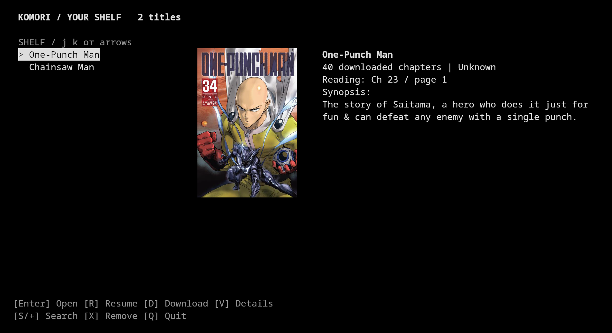

<div align="center">

# Komori

**Your manga shelf, in the terminal.**

Browse covers · read local chapters · pick up where you left off




<sub>Actual application capture in Kitty on Linux/X11, using an existing local library and cover. No UI mockup. Cover artwork belongs to its respective rights holders; chapter files and personal configuration are not included.</sub>

[Get started](#get-started) · [Keyboard](#keyboard) · [Commands](#commands) · [Storage & safety](#storage--safety) · [Tests](#tests)

</div>

---

## A cover-first shelf

- **Browse without leaving the terminal.** The selected title's cover, synopsis, publication status, local chapter count, and reading position sit beside a scrolling shelf.
- **Resume local reading.** Reading progress is saved separately from chapter files. Imported libraries keep their original files untouched.
- **Search before downloading.** Results must have a real, nonempty remote chapter listing. Select individual chapters, decimal chapters, or ranges with gaps.
- **Keep incomplete downloads out of the reader.** Chapters are marked incomplete until all listed pages pass basic image-signature checks. Retry to reuse valid existing pages.
- **Adapt to the terminal.** Wide windows show shelf and details side by side; smaller windows rearrange them. Very narrow windows prioritize text.

No web server, account, or required pip packages. The core uses Python's standard library and `curses`.

## Get started

**Requirements:** Python 3.9+ with `curses`, and a Unix-like terminal. Linux is the exercised platform; macOS has not been verified. Native Windows is not supported by this setup (use a suitable Linux environment such as WSL).

For inline cover artwork, use **Kitty with `kitten` available, outside tmux**. Merely installing `kitten` does not enable images in other terminals. Without Kitty, the shelf uses an ASCII cover if optional Pillow is installed, or a framed text placeholder otherwise. Cover browsing does not open a desktop image viewer.

```bash
git clone https://github.com/whale2186/komori.git
cd komori
python3 src/komori.py --help
python3 src/komori.py
```

Optional user-local command, run from the cloned project directory:

```bash
mkdir -p "$HOME/.local/bin"
chmod +x src/komori.py
# Omit -f: an existing command is not overwritten.
ln -s "$PWD/src/komori.py" "$HOME/.local/bin/komori"
export PATH="$HOME/.local/bin:$PATH"
komori
```

Add the PATH line to your shell configuration if needed. Keep the clone in place: the symlink points to it, and `src/komori_runtime.py` must remain beside the entry point. No installation step is needed if you prefer `python3 src/komori.py`.

On a fresh setup the shelf is empty. Press **S** to search, **Enter** to preview a result, then **A** to add it. A previous `opm` library is imported automatically when present; see the safety notes below.

## Keyboard

| Screen | Keys | Action |
| :-- | :-- | :-- |
| Shelf | Arrows, `j` / `k` (also `h` / `l`) | Select a title |
| Shelf | Page Up / Page Down, Home / End | Navigate the shelf |
| Shelf | Enter / `r` | Open title / resume reading |
| Shelf | `s` or `+` / `v` / `d` | Search / cover and details / download |
| Shelf | `x` | Remove a library record after confirmation, not its files |
| Search | Arrows or `j` / `k`, Enter | Select and preview |
| Search preview | `a` / `d` | Add / add and choose downloads |
| Manga | `r` / `v` / `d` / `x` | Resume / details / download / delete a Komori chapter |
| Reader | Left / Right, `h` / `l`, Space | Navigate pages |
| Reader | `i` | Explicitly request the inherited external page viewer |
| Any screen | `q` | Back; quit from the shelf |

Reading progress saves automatically. Artwork is cleared when switching screens, resizing, and quitting.

## Commands

```bash
komori                           # Interactive shelf
komori --help
komori list                      # Local titles and reading progress
komori search Yotsuba             # Metadata; offers add prompt in a terminal
komori chapters Yotsuba           # Remote listing, no chapter image downloads
komori cover 1                    # Cover and synopsis of local title #1
komori resume 1
komori dl 1 '1-5'                 # Only chapters actually present in the listing
komori dl 1 '0.5,1,1.5'           # Decimal chapter numbers are preserved
komori rm 1 '1-5'                 # Delete selected Komori-owned local chapters
```

Title arguments accept a local library index or matching name; quote names with spaces. Omit the title where supported to use the active title. `chapters` resolves a local title first, otherwise searches the supplied query. Noninteractive `search` prints results without an add prompt.

### Availability means what it says

> **Remotely listed; pages not checked** means a real chapter entry was returned—not that its images can currently be retrieved.

Search validates listings, not page bytes. Chapter ranges select only listed numbers (including fractions); they do not invent missing chapters. Unknown publication status remains **Unknown**.

Downloads require a nonempty page manifest and nonempty, recognized image signatures for each page. This is not full image decoding or a guarantee against corruption. Incomplete chapters are hidden from reading; completion manifests record page filenames and counts. Download summaries distinguish successful and failed chapters, with a nonzero CLI exit on download or selection failure.

Use remote content only where you have permission and comply with applicable laws and source terms.

---

## Storage & safety

| Data | Default location |
| :-- | :-- |
| Library metadata | `~/.config/komori/library.json` |
| New reading progress | `~/.config/komori/progress/` |
| Cached covers | `~/.cache/komori/covers/` |
| New chapter downloads | `~/Downloads/Komori/` |

`XDG_CONFIG_HOME` and `XDG_CACHE_HOME` override the config and cache roots. Download storage remains under your home directory.

**Import is a snapshot, not a migration.** On first use, `~/.config/opm/library.json`, if present, is copied into Komori's configuration. Imported manga directories remain in place and are marked read-only. Original chapter files and legacy reading progress remain readable; new progress goes only into Komori's configuration. Downloads and chapter deletion are blocked for imported records. Search and add an imported title again to point its Komori record at a new Komori download directory, leaving the original untouched.

An empty saved library stays empty. Malformed Komori metadata is preserved rather than silently replaced. Removing a shelf entry removes only the record. Missing covers are fetched by a single background worker, validated for an image signature, capped at 8 MiB, and written atomically into Komori's cache; shelf browsing does not download chapters.

Personal metadata, progress, downloaded chapters, caches, secrets, and local verification reports are excluded by `.gitignore`. The screenshot is the only bundled example artwork; no sample chapter library is distributed.

## Tests

From the project root:

```bash
python3 -m unittest discover -s tests -v
python3 -m py_compile src/komori.py src/komori_runtime.py
```

The default suite uses synthetic fixtures and isolated temporary homes for PTY tests. It runs directly from source without an installed `komori` command or your personal library. It covers listing selection, failed downloads, import protection, progress, terminal gating, artwork placement, responsive bounds, cover fetching, redraw races, and PTY navigation/resize/quit. The installed-command smoke is opt-in:

```bash
KOMORI_TEST_INSTALLED=1 python3 -m unittest discover -s tests -v
```

<details>
<summary>Local, live verification scripts</summary>

These are separate from offline tests and assume `~/.local/bin/komori` is installed:

```bash
python3 verify.py
python3 verify_frontpage.py
```

`verify.py` runs real CLI commands and checks remote chapter/page-URL metadata without downloading chapter images. `verify_frontpage.py` uses your existing Komori library and covers to check text and Kitty-protocol PTYs, navigation, resize, exit, and protected-file hashes. It requires an existing saved library. Protocol output alone is not proof of graphical rendering; the README image was separately captured from the real graphical application and visually inspected.

Both write ignored local JSON reports containing personal filesystem paths and command output. **Do not upload those reports.** Live network failure is reported, not replaced with fabricated results.

</details>

## Known limits

- Remote services can change their markup, block requests, or disappear. A listing is not a promise of image availability.
- The inherited supplementary API feed reads at most 500 releases per title; larger series may have more chapters than are shown.
- Artwork is a selected-cover hero, not a multi-cover gallery. Kitty graphics are disabled inside tmux; small windows may hide covers.
- A graphical Kitty front page was visually verified on Linux/X11. This does not certify every terminal, every resize transition, or every interactive flow.
- Reader/download automation uses synthetic fixtures. Full image decoding, long-download performance, and external-viewer launch are not end-to-end verified.
- The inherited implementation is in `src/komori.py`; adaptations load from `src/komori_runtime.py`. Some superseded legacy code remains. Its old optional Imgur path reads `IMGUR_CLIENT_ID` from the environment; the active runtime download path does not require it. No credentials are bundled.

## Provenance & licensing

Komori adapts an existing terminal manga reader with additional library, safety, availability, and cover-first UI behavior. The inherited code's licensing provenance has not been established, so **no license is assigned here**. Public visibility does not grant a reuse license. Manga artwork and content remain the property of their respective rights holders.
